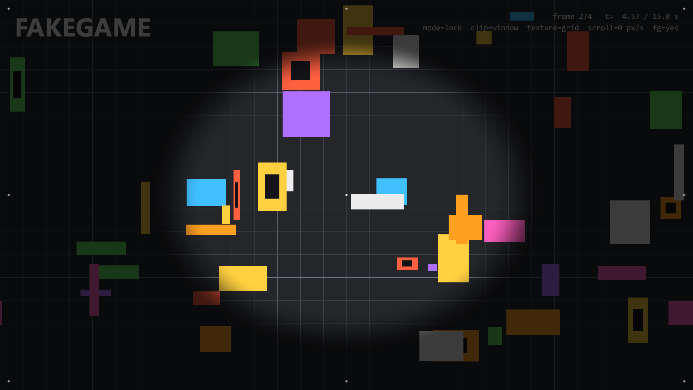
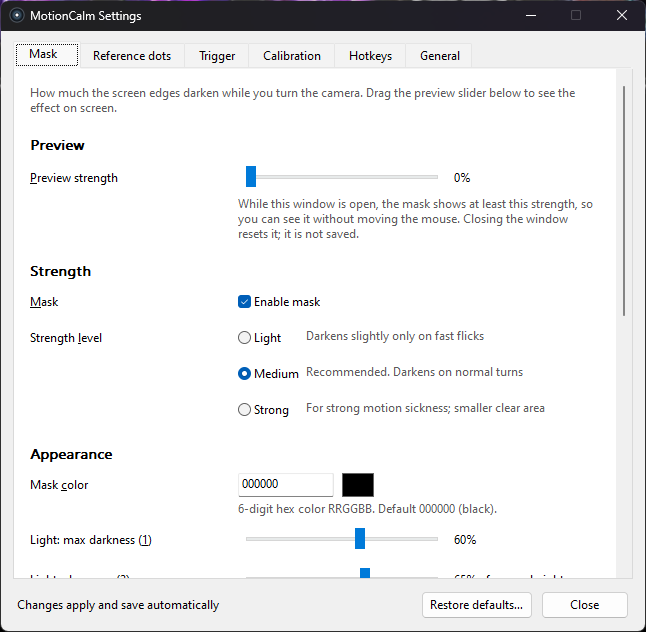
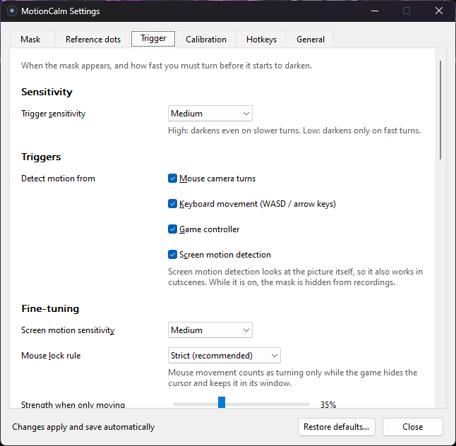
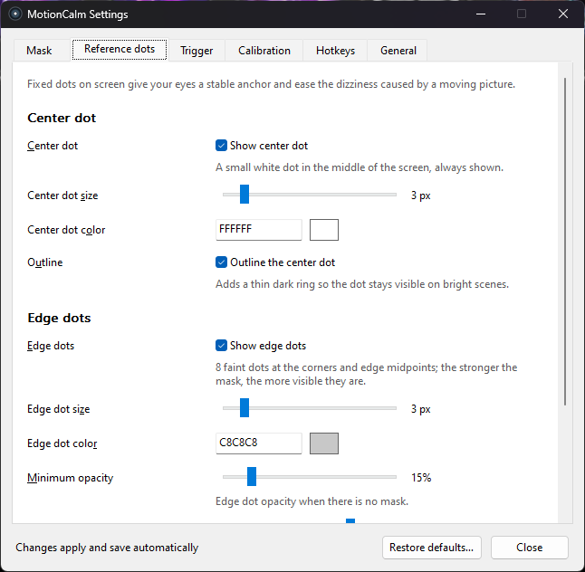

# MotionCalm

**English** | [简体中文](README.zh-CN.md) | [繁體中文](README.zh-TW.md)

[](https://github.com/LChouRepo/MotionCalm/releases/latest)
[](LICENSE)
[](#download)
[](https://github.com/LChouRepo/MotionCalm/actions/workflows/build.yml)

MotionCalm is a small Windows overlay for people who get motion sick playing first-person games on a
monitor. While you turn the camera, move, or the picture shakes, it smoothly darkens the edges of the
screen and keeps the centre clear, and it keeps a fixed dot in the middle of the screen as a stable
reference; about half a second after you stop, the mask fades out. It brings two techniques studied in
VR research — dynamic field-of-view restriction and a fixed visual reference such as a "virtual nose" —
to any game on an ordinary monitor, without touching the game itself.



<sub>Screenshot from the bundled test scene (`tools/fakegame`) while turning at full strength. Idle, the
same scene has no mask — see [`docs/images/mask-idle.png`](docs/images/mask-idle.png).</sub>

## Features

- **Dynamic edge mask** driven by what you do and what you see:
  - mouse camera turns (only while the game locks the cursor), WASD / arrow-key movement, and game
    controller sticks (XInput);
  - **screen motion detection** (optional, on by default) for motion you don't cause yourself —
    screen shake, head bob, cutscenes, vehicles — including **moving forward / backward** and
    **camera roll (tilt)**.
- **Fixed reference dots**: a small centre dot that is always shown, plus eight faint dots at the
  screen corners and edge midpoints that become more visible as the mask gets stronger.
- **Per-game calibration**: turn a full circle twice and MotionCalm knows how many degrees per second
  you are really turning in that game.
- **Settings window** where every change applies and saves immediately, with a preview slider;
  three mask levels (Light / Medium / Strong) and three trigger sensitivities; customizable global
  hotkeys; tray menu.
- **Three languages**: English, Simplified Chinese and Traditional Chinese; by default it follows the
  Windows display language.
- **No injection, no memory reading**: MotionCalm never touches the game process or its files and
  installs no input hooks. It is a click-through transparent window on top of the screen.
- **Lightweight**: about 1–2% of one CPU core while you play, practically 0 when you are not in a
  game. Portable single `.exe`, no installer, no dependencies.

<table>
  <tr>
    <td></td>
    <td></td>
    <td></td>
  </tr>
</table>

## Download

Download the latest **`MotionCalm-v<version>-win64.zip`** from the
[Releases page](https://github.com/LChouRepo/MotionCalm/releases/latest). The zip contains
`MotionCalm.exe`, the default `MotionCalm.ini`, `LICENSE` and the user guide in three languages
(`USER-GUIDE.en.md`, `USER-GUIDE.zh-CN.md`, `USER-GUIDE.zh-TW.md`).

- **Requirements:** Windows 10 (version 2004 or later) or Windows 11, 64-bit.
- **SmartScreen:** the program is not code-signed, so the first time Windows may show
  "Windows protected your PC". Click **More info → Run anyway**.
- **Display mode:** run the game in **borderless window** or **windowed fullscreen** mode. In exclusive
  fullscreen the game covers the overlay and you won't see the mask.

## Quick start

1. Extract the zip to any folder (don't run it from inside the zip) and double-click `MotionCalm.exe`.
   A round icon appears in the system tray: double-click it for Settings, right-click it for the menu.
2. Start your game in borderless window mode and turn the camera. MotionCalm recognizes the game when
   it locks the mouse; quick turns now darken the screen edges.
3. Calibrate once per game: aim at a landmark, press **Ctrl+Alt+F7**, turn exactly one full circle,
   press **Ctrl+Alt+F7** again, then repeat for the second run.
4. Pick a mask level with **Ctrl+Alt+F10** (Light → Medium → Strong) or in Settings → Mask. If slow
   turns still make you sick, set Settings → Trigger → Trigger sensitivity to High.
5. Toggle the mask with **Ctrl+Alt+F9** and the centre dot with **Ctrl+Alt+F11**. All hotkeys can be
   changed in Settings → Hotkeys.

The full [user guide](docs/user-guide.en.md) covers game settings to change first, every setting,
tips for swimming / flying / driving games, and an FAQ.

## How it works

- **Input:** Raw Input (mouse and keyboard, no hooks) and XInput are turned into a camera speed in
  degrees per second, using the per-game calibration.
- **Game detection:** mouse turns count only while the foreground program hides and locks the cursor;
  browsers and video players are excluded by default.
- **Screen motion:** DXGI Desktop Duplication captures the game's monitor and downscales it on the GPU
  to a 160×90 grayscale grid; projection cross-correlation estimates panning, and a robust
  similarity-transform estimator measures forward / backward motion and roll. Frames stay in memory and
  are never saved or sent anywhere. While this is on, the overlay is hidden from screen capture so it
  doesn't see itself — which also means the mask doesn't show up in screenshots or streams.
- **Intensity model:** each source is mapped to 0–1 between a start and a full threshold, the maximum
  wins, and the result is smoothed (about 0.1 s to appear, 0.5 s to fade).
- **Rendering:** a click-through Direct3D 11 + DirectComposition window draws the elliptical mask and
  the dots in one pixel shader, and presents only when something changes.

Details: [DESIGN.md](DESIGN.md) and the requirement specs in [`openspec/specs/`](openspec/specs/)
(both written in Simplified Chinese).

## Anti-cheat and fair play

MotionCalm doesn't inject into games, read game memory or modify game files; it works like the Discord
or OBS overlays. However, **the centre dot effectively acts as a crosshair overlay**, which some
tournament and platform rules forbid. Before official or ranked matches, turn the centre dot off
(**Ctrl+Alt+F11**) or exit MotionCalm, and check the current rules of the game or platform (for
example Valorant or FACEIT) yourself.

## Build from source

Requirements: Windows 10/11 x64 and **Visual Studio 2022 or 2026** (any edition, or Build Tools) with
the **Desktop development with C++** workload (MSVC x64 tools and a Windows 10/11 SDK). There are no
other dependencies. `scripts\env.cmd` finds Visual Studio with `vswhere.exe`; set `MC_VS_PATH` to your
Visual Studio install folder if it isn't found.

```bat
:: from a normal cmd prompt in the repository root
build.cmd all release        :: MotionCalm.exe + test tools + tests.exe (the unit tests run automatically)
build.cmd app debug          :: targets: all | app | tools | tests; configs: debug | release
out\release\tests.exe        :: run the unit tests again

:: release zip -> out\MotionCalm-v<version>-win64.zip
powershell -ExecutionPolicy Bypass -File scripts\package.ps1 -Version 1.2.0
```

Everything goes to `out\<config>\` (objects in `out\<config>\obj\`). The test tools are built with
`build.cmd tools`: `fakegame.exe` (fake full-screen game window), `inputsim.exe` (synthetic mouse
movement), `capturetest.exe` (screen-capture benchmark; `--record` / `--replay` save and replay grid clips offline) and `settingsdemo.exe` (settings window with a
fake host, for screenshots). Live verification scripts are described in
[CONTRIBUTING.md](CONTRIBUTING.md).

## Project layout

| Path | Contents |
|---|---|
| `src/app/` | Entry point, message loop, tick, settings host |
| `src/input/` | Raw Input mouse / keyboard, XInput controllers |
| `src/detect/` | Foreground game detection, cursor lock, exclusion list |
| `src/model/` | Intensity model (pure logic) |
| `src/capture/` | Desktop Duplication, GPU downscale, motion and similarity estimators |
| `src/calib/` | In-game calibration state machine |
| `src/overlay/` | Overlay window, Direct3D 11 / DirectComposition renderer, shaders |
| `src/tray/` | Tray icon and menu, global hotkeys |
| `src/ui/` | Settings window and its six pages |
| `src/i18n/` | UI string tables (zh-CN, zh-TW, en) |
| `src/config/`, `src/util/`, `src/res/` | INI configuration, logging and helpers, resources and default INI |
| `tests/` | Unit tests (`tests.exe`, built-in micro test framework); `tests/fixtures/README.md` explains recording and replaying capture clips |
| `tools/` | `fakegame`, `inputsim`, `capturetest`, `settingsdemo`, icon generator |
| `scripts/` | Build scripts, packaging, live verification scripts |
| `openspec/` | OpenSpec specs and archived changes |
| `docs/` | User guides, settings UI rules, images |

## Documentation

- User guide: [English](docs/user-guide.en.md) · [简体中文](docs/user-guide.zh-CN.md) · [繁體中文](docs/user-guide.zh-TW.md)
- [DESIGN.md](DESIGN.md) — overall design (Simplified Chinese)
- [docs/settings-ui.md](docs/settings-ui.md) — settings window layout and wording rules (Simplified Chinese)
- [openspec/specs/](openspec/specs/) — requirements per capability; [openspec/changes/archive/](openspec/changes/archive/) — history of changes (Simplified Chinese)
- [CHANGELOG.md](CHANGELOG.md) · [SECURITY.md](SECURITY.md)

## Contributing

Bug reports, game compatibility notes and pull requests are welcome. Please read
[CONTRIBUTING.md](CONTRIBUTING.md) first. When reporting a bug, attach `MotionCalm.log`
(tray menu → Open log) and tell us the game, Windows version and display mode.

## License

[MIT](LICENSE) © 2026 LChouRepo

## Acknowledgements and research

MotionCalm applies ideas from motion sickness research to desktop games. It is not a medical device.

- D. M. Whittinghill, B. Ziegler, T. Case and B. Moore, "Nasum Virtualis: A Simple Technique for
  Reducing Simulator Sickness", Game Developers Conference (GDC), 2015 — the Purdue University "virtual
  nose" study: a fixed visual reference in view reduced simulator sickness.
- A. S. Fernandes and S. K. Feiner, "Combating VR Sickness through Subtle Dynamic Field-of-View
  Modification", IEEE Symposium on 3D User Interfaces (3DUI), 2016.
- J. Teixeira and S. Palmisano, "Effects of dynamic field-of-view restriction on cybersickness and
  presence in HMD-based virtual reality", Virtual Reality, 2020 (published online; vol. 25, 2021).
- S. C. de Vries et al., "Internal and external field of view: computer games and cybersickness", Proceedings of the 1st International Symposium on Visually Induced Motion Sickness, Fatigue, Photosensitive Epileptic Seizures (VIMS), Hong Kong, 2007.
