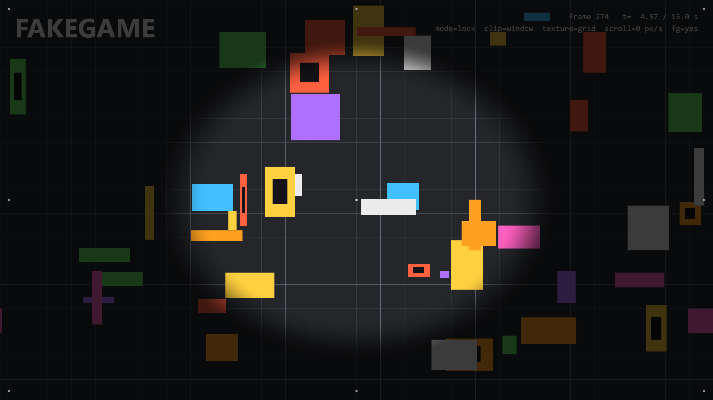
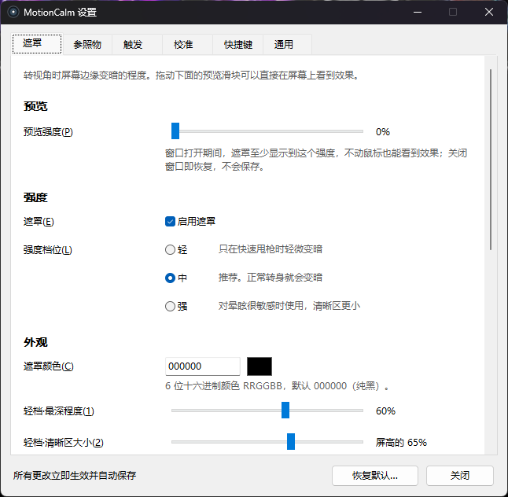
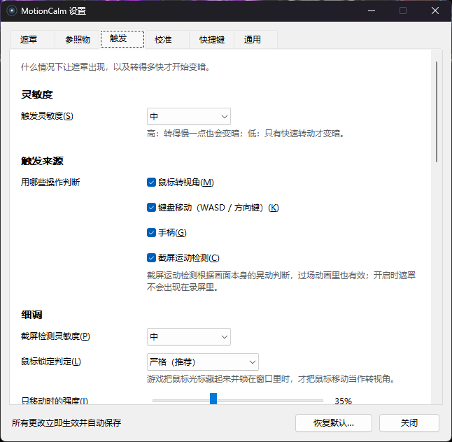
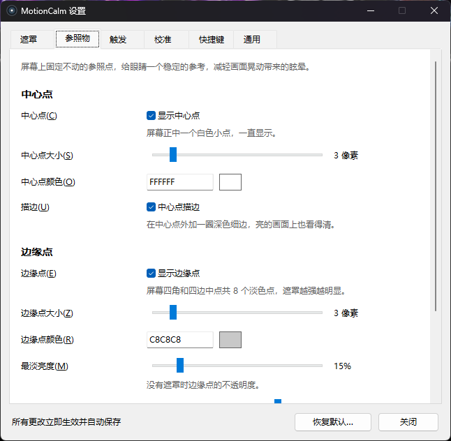

# MotionCalm 防晕遮罩

[English](README.md) | **简体中文** | [繁體中文](README.zh-TW.md)

[](https://github.com/LChouRepo/MotionCalm/releases/latest)
[](LICENSE)
[](#下载)
[](https://github.com/LChouRepo/MotionCalm/actions/workflows/build.yml)

MotionCalm 是一个小巧的 Windows 屏幕叠加层，给在显示器上玩第一人称游戏容易 3D 眩晕的人用。你转视角、走动或画面晃动时，
它会把屏幕四周平滑地压暗、只留中间清晰，同时在屏幕正中常驻一个固定的小点作为参照；停下来约半秒后遮罩自动淡出。
它把 VR 研究里验证过的两种做法——动态缩小视野（FOV restriction）和固定视觉参照物（如"虚拟鼻子"）——带到普通显示器上的任何游戏，
完全不碰游戏本身。



<sub>截图来自自带的测试场景（`tools/fakegame`），转动中、满强度。静止时同一场景没有遮罩，见 [`docs/images/mask-idle.png`](docs/images/mask-idle.png)。</sub>

## 功能

- **动态边缘遮罩**，根据你的操作和画面本身判断：
  - 鼠标转视角（只在游戏锁住鼠标时算）、WASD / 方向键移动、手柄摇杆（XInput）；
  - **截屏运动检测**（可关，默认开）：处理不是你自己造成的晃动——震屏、镜头摆动、过场动画、载具——
    包括**往前 / 往后冲**和**镜头倾斜**。
- **固定参照点**：屏幕正中常驻一个小白点，屏幕四角和四边中点另有 8 个淡色点，遮罩越强越明显。
- **按游戏校准**：在游戏里水平转两整圈，程序就知道你在这个游戏里每秒实际转了多少度。
- **设置窗口**：所有改动立即生效、自动保存，带预览滑块；遮罩三档（轻 / 中 / 强）、触发灵敏度三档；
  全局快捷键可自定义；托盘菜单。
- **三种界面语言**：简体中文、繁體中文、English，默认跟随 Windows 显示语言。
- **不注入、不读内存**：不碰游戏进程和游戏文件，也不装输入钩子，只是一层点击穿透的透明窗口。
- **占用低**：游戏中约占单核 CPU 的 1–2%，不在游戏时几乎为 0。单个 `.exe`，免安装、无依赖。

<table>
  <tr>
    <td></td>
    <td></td>
    <td></td>
  </tr>
</table>

## 下载

从 [Releases 页面](https://github.com/LChouRepo/MotionCalm/releases/latest) 下载最新的 **`MotionCalm-v<版本>-win64.zip`**。
压缩包里有 `MotionCalm.exe`、默认配置 `MotionCalm.ini`、`LICENSE`，以及三种语言的使用说明
（`USER-GUIDE.zh-CN.md`、`USER-GUIDE.zh-TW.md`、`USER-GUIDE.en.md`）。

- **系统要求**：Windows 10（2004 及以上）或 Windows 11，64 位。
- **SmartScreen**：程序没有代码签名，第一次运行时 Windows 可能弹出"Windows 已保护你的电脑"，点 **更多信息 → 仍要运行**。
- **显示模式**：游戏要用**无边框窗口**或**窗口化全屏**。独占全屏时游戏会盖住遮罩，看不见。

## 快速上手

1. 把压缩包解压到任意文件夹（不要在压缩包里直接运行），双击 `MotionCalm.exe`。托盘区会出现一个圆形图标：双击打开设置，右键打开菜单。
2. 用无边框窗口模式进游戏，转一下视角。游戏锁住鼠标后程序会自动认出它；之后快速转身时屏幕四周会变暗。
3. 每个游戏校准一次：准星对准一个参照物，按 **Ctrl+Alt+F7**，水平转一整圈回到原处，再按 **Ctrl+Alt+F7**；然后照样做第 2 次。
4. 用 **Ctrl+Alt+F10**（轻 → 中 → 强）或 设置 → 遮罩 选档位。转得慢也晕，就把 设置 → 触发 → 触发灵敏度 调成"高"。
5. **Ctrl+Alt+F9** 开关遮罩，**Ctrl+Alt+F11** 开关中心点。所有快捷键都能在 设置 → 快捷键 里改。

完整的[使用说明](docs/user-guide.zh-CN.md)里有：先改哪些游戏设置、每个设置项的含义、游泳 / 飞行 / 驾驶类游戏的建议、常见问题。

## 工作原理

- **输入**：Raw Input（鼠标、键盘，不装钩子）和 XInput 换算成以"度 / 秒"计的镜头速度，按游戏使用校准值。
- **游戏判定**：只有前台程序隐藏并锁住鼠标光标时，鼠标移动才算转视角；浏览器和视频播放器默认在排除名单里。
- **画面运动**：用 DXGI 桌面复制采集游戏所在的显示器，在 GPU 上缩成 160×90 的灰度网格；投影互相关估计平移，
  鲁棒的相似变换估计器测出前进 / 后退与倾斜。画面只在内存里处理，不保存、不发送。开启时遮罩对截屏隐藏，
  避免程序看到自己——所以截图和直播里也看不到遮罩。
- **强度模型**：每个来源按"开始 / 满强度"两个阈值映射到 0–1，取最大值，再做平滑（约 0.1 秒出现、0.5 秒淡出）。
- **渲染**：点击穿透的 Direct3D 11 + DirectComposition 窗口，用一个像素着色器画椭圆遮罩和参照点，只在画面有变化时才提交。

详见 [DESIGN.md](DESIGN.md) 和 [`openspec/specs/`](openspec/specs/) 下的需求规格。

## 反作弊与公平竞技

MotionCalm 不注入游戏、不读游戏内存、不改游戏文件，原理和 Discord、OBS 的叠加层一样。但要注意：
**屏幕中心的白点在效果上相当于"准星叠加"**，部分比赛 / 平台规则禁止这类东西。打正式比赛或排位前，
请按 **Ctrl+Alt+F11** 关掉中心点或直接退出程序，并自行确认游戏 / 平台（例如 Valorant、FACEIT）的最新规则。

## 从源码构建

需要 Windows 10/11 x64 和 **Visual Studio 2022 或 2026**（任意版本，或 Build Tools），安装
**"使用 C++ 的桌面开发"** 工作负载（含 MSVC x64 工具和 Windows 10/11 SDK），没有其他依赖。
`scripts\env.cmd` 用 `vswhere.exe` 查找 Visual Studio；找不到时把环境变量 `MC_VS_PATH` 设为 Visual Studio 的安装文件夹。

```bat
:: 在仓库根目录的普通 cmd 窗口里
build.cmd all release        :: MotionCalm.exe + 测试工具 + tests.exe（单元测试自动运行）
build.cmd app debug          :: 目标：all | app | tools | tests；配置：debug | release
out\release\tests.exe        :: 再跑一次单元测试

:: 发布包 -> out\MotionCalm-v<版本>-win64.zip
powershell -ExecutionPolicy Bypass -File scripts\package.ps1 -Version 1.1.0
```

所有输出在 `out\<配置>\`（中间文件在 `out\<配置>\obj\`）。`build.cmd tools` 构建测试工具：`fakegame.exe`（假的全屏游戏窗口）、
`inputsim.exe`（模拟鼠标移动）、`capturetest.exe`（截屏性能测试）、`settingsdemo.exe`（用假宿主打开设置窗口，用于截图）。
实机验证脚本见 [CONTRIBUTING.zh-CN.md](CONTRIBUTING.zh-CN.md)。

## 目录结构

| 路径 | 内容 |
|---|---|
| `src/app/` | 程序入口、消息循环、tick、设置宿主 |
| `src/input/` | Raw Input 鼠标 / 键盘、XInput 手柄 |
| `src/detect/` | 前台游戏判定、光标锁定、排除名单 |
| `src/model/` | 强度模型（纯逻辑） |
| `src/capture/` | 桌面复制、GPU 降采样、位移与相似变换估计 |
| `src/calib/` | 游戏内校准状态机 |
| `src/overlay/` | 遮罩窗口、Direct3D 11 / DirectComposition 渲染、着色器 |
| `src/tray/` | 托盘图标与菜单、全局快捷键 |
| `src/ui/` | 设置窗口及 6 个分页 |
| `src/i18n/` | 界面文字表（zh-CN、zh-TW、en） |
| `src/config/`、`src/util/`、`src/res/` | INI 配置、日志与工具函数、资源与默认 INI |
| `tests/` | 单元测试（`tests.exe`，自带极简测试框架） |
| `tools/` | `fakegame`、`inputsim`、`capturetest`、`settingsdemo`、图标生成脚本 |
| `scripts/` | 构建、打包、实机验证脚本 |
| `openspec/` | OpenSpec 需求规格与已归档的变更 |
| `docs/` | 使用说明、设置窗口界面规范、图片 |

## 文档

- 使用说明：[简体中文](docs/user-guide.zh-CN.md) · [繁體中文](docs/user-guide.zh-TW.md) · [English](docs/user-guide.en.md)
- [DESIGN.md](DESIGN.md)：总体设计
- [docs/settings-ui.md](docs/settings-ui.md)：设置窗口的版式与文案规范
- [openspec/specs/](openspec/specs/)：各功能的需求规格；[openspec/changes/archive/](openspec/changes/archive/)：历次变更
- [CHANGELOG.md](CHANGELOG.md)（更新日志，仅英文）· [SECURITY.md](SECURITY.md)（安全说明，英文）

## 参与贡献

欢迎提交 bug、游戏兼容性反馈和 Pull Request，请先阅读 [CONTRIBUTING.zh-CN.md](CONTRIBUTING.zh-CN.md)。
报告 bug 时请附上 `MotionCalm.log`（托盘菜单 → 打开日志），并写明游戏名、Windows 版本和显示模式。

## 许可证

[MIT](LICENSE) © 2026 LChouRepo

## 致谢与研究依据

MotionCalm 把晕动症研究里的思路用在电脑游戏上，它不是医疗器械。

- D. M. Whittinghill, B. Ziegler, T. Case, B. Moore, "Nasum Virtualis: A Simple Technique for Reducing
  Simulator Sickness", Game Developers Conference (GDC), 2015——普渡大学的"虚拟鼻子"研究：视野中固定的参照物能减轻模拟器晕动。
- A. S. Fernandes, S. K. Feiner, "Combating VR Sickness through Subtle Dynamic Field-of-View Modification",
  IEEE Symposium on 3D User Interfaces (3DUI), 2016.
- J. Teixeira, S. Palmisano, "Effects of dynamic field-of-view restriction on cybersickness and presence in
  HMD-based virtual reality", Virtual Reality, 2020（在线发表；2021 年第 25 卷）.
- S. C. de Vries et al., "Internal and external field of view: computer games and cybersickness", Proceedings of the 1st International Symposium on Visually Induced Motion Sickness, Fatigue, Photosensitive Epileptic Seizures (VIMS), Hong Kong, 2007.
