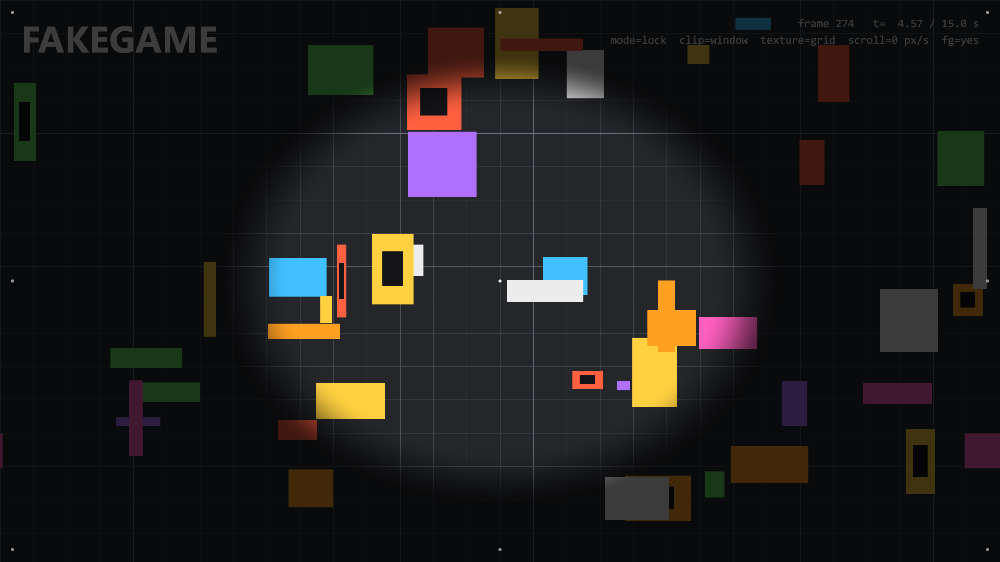
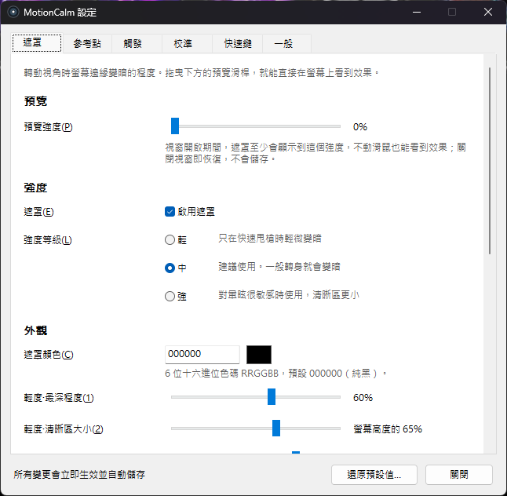
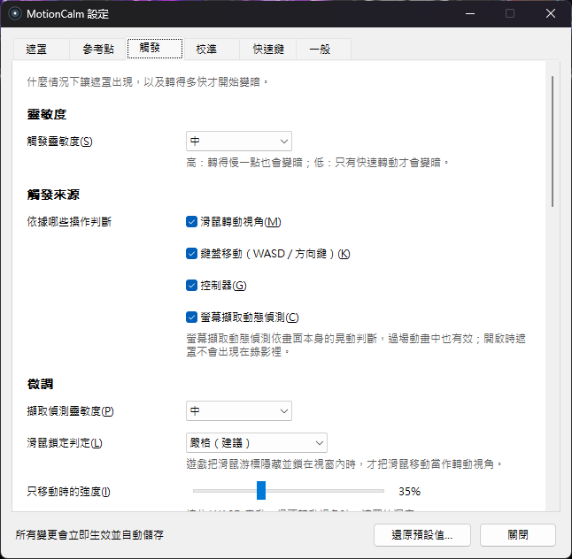
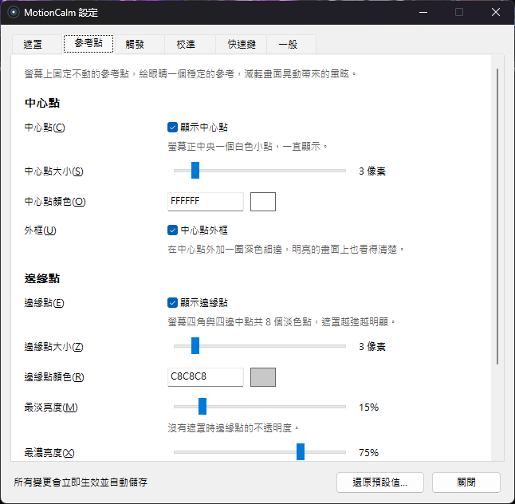

# MotionCalm 防暈遮罩

[English](README.md) | [简体中文](README.zh-CN.md) | **繁體中文**

[](https://github.com/LChouRepo/MotionCalm/releases/latest)
[](LICENSE)
[](#下載)
[](https://github.com/LChouRepo/MotionCalm/actions/workflows/build.yml)

MotionCalm 是一個小巧的 Windows 螢幕疊加層，給在螢幕上玩第一人稱遊戲容易 3D 暈眩的人使用。當你轉動視角、走動或畫面晃動時，
它會把螢幕四周平滑地調暗、只留中間清楚，同時在螢幕正中央常駐一個固定的小點作為參考；停下來約半秒後遮罩就會自動淡出。
它把 VR 研究中驗證過的兩種做法——動態縮小視野（FOV restriction）和固定的視覺參考物（例如「虛擬鼻子」）——帶到一般螢幕上的任何遊戲，
完全不碰遊戲本身。



<sub>擷取畫面來自內附的測試場景（`tools/fakegame`），轉動中、滿強度。靜止時同一場景沒有遮罩，請見 [`docs/images/mask-idle.png`](docs/images/mask-idle.png)。</sub>

## 功能

- **動態邊緣遮罩**，根據你的操作和畫面本身判斷：
  - 滑鼠轉動視角（只在遊戲鎖住滑鼠時才算）、WASD / 方向鍵移動、控制器搖桿（XInput）；
  - **螢幕擷取動態偵測**（可關閉，預設開啟）：處理不是你自己造成的晃動——畫面震動、鏡頭擺動、過場動畫、載具——
    包括**往前 / 往後衝**和**鏡頭傾斜**。
- **固定參考點**：螢幕正中央常駐一個小白點，螢幕四角和四邊中點另有 8 個淡色點，遮罩越強越明顯。
- **依遊戲校準**：在遊戲中水平轉兩整圈，程式就知道你在這款遊戲裡每秒實際轉了幾度。
- **設定視窗**：所有變更立即生效並自動儲存，附預覽滑桿；遮罩三個等級（輕 / 中 / 強）、觸發靈敏度三個等級；
  全域快速鍵可自訂；系統匣選單。
- **三種介面語言**：简体中文、繁體中文、English，預設跟隨 Windows 顯示語言。
- **不注入、不讀取記憶體**：不碰遊戲程序和遊戲檔案，也不安裝輸入攔截（hook），只是一層點擊穿透的透明視窗。
- **資源占用低**：遊戲中約占單核心 CPU 的 1–2%，不在遊戲中時幾乎為 0。單一 `.exe`，免安裝、無相依套件。

<table>
  <tr>
    <td></td>
    <td></td>
    <td></td>
  </tr>
</table>

## 下載

從 [Releases 頁面](https://github.com/LChouRepo/MotionCalm/releases/latest) 下載最新的 **`MotionCalm-v<版本>-win64.zip`**。
壓縮檔裡有 `MotionCalm.exe`、預設設定檔 `MotionCalm.ini`、`LICENSE`，以及三種語言的使用說明
（`USER-GUIDE.zh-TW.md`、`USER-GUIDE.zh-CN.md`、`USER-GUIDE.en.md`）。

- **系統需求**：Windows 10（2004 以上）或 Windows 11，64 位元。
- **SmartScreen**：程式沒有程式碼簽章，第一次執行時 Windows 可能會跳出「Windows 已保護您的電腦」，按 **其他資訊 → 仍要執行**。
- **顯示模式**：遊戲要使用**無邊框視窗**或**視窗化全螢幕**。獨占全螢幕時遊戲會蓋住遮罩，看不到。

## 快速上手

1. 把壓縮檔解壓縮到任意資料夾（不要在壓縮檔裡直接執行），按兩下 `MotionCalm.exe`。系統匣會出現一個圓形圖示：按兩下開啟設定，按右鍵開啟選單。
2. 用無邊框視窗模式進入遊戲，轉一下視角。遊戲鎖住滑鼠後程式會自動辨識；之後快速轉身時螢幕四周就會變暗。
3. 每款遊戲校準一次：準星對準一個參考物，按 **Ctrl+Alt+F7**，水平轉一整圈回到原處，再按 **Ctrl+Alt+F7**；然後照樣做第 2 次。
4. 用 **Ctrl+Alt+F10**（輕 → 中 → 強）或 設定 → 遮罩 選擇等級。轉得慢也會暈，就把 設定 → 觸發 → 觸發靈敏度 調成「高」。
5. **Ctrl+Alt+F9** 開啟 / 關閉遮罩，**Ctrl+Alt+F11** 開啟 / 關閉中心點。所有快速鍵都能在 設定 → 快速鍵 裡修改。

完整的[使用說明](docs/user-guide.zh-TW.md)包含：先調整哪些遊戲設定、每個設定項目的意思、游泳 / 飛行 / 駕駛類遊戲的建議、常見問題。

## 運作原理

- **輸入**：Raw Input（滑鼠、鍵盤，不安裝 hook）和 XInput 換算成以「度 / 秒」計的鏡頭速度，依遊戲套用校準值。
- **遊戲判定**：只有前景程式隱藏並鎖住滑鼠游標時，滑鼠移動才算轉動視角；瀏覽器和影片播放程式預設在排除清單裡。
- **畫面動態**：用 DXGI 桌面複製擷取遊戲所在的螢幕，在 GPU 上縮成 160×90 的灰階網格；投影互相關估計平移，
  穩健的相似變換估計器量出前進 / 後退與傾斜。畫面只在記憶體中處理，不儲存、不傳送。開啟時遮罩對螢幕擷取隱藏，
  避免程式看到自己——所以擷取畫面和直播裡也看不到遮罩。
- **強度模型**：每個來源依「開始 / 滿強度」兩個門檻值對應到 0–1，取最大值，再做平滑處理（約 0.1 秒出現、0.5 秒淡出）。
- **繪製**：點擊穿透的 Direct3D 11 + DirectComposition 視窗，用一個像素著色器畫出橢圓遮罩和參考點，只在畫面有變化時才送出。

詳見 [DESIGN.md](DESIGN.md) 和 [`openspec/specs/`](openspec/specs/) 下的需求規格（以簡體中文撰寫）。

## 反作弊與公平競技

MotionCalm 不注入遊戲、不讀取遊戲記憶體、不修改遊戲檔案，原理和 Discord、OBS 的疊加層一樣。但要注意：
**螢幕中央的白點在效果上相當於「準星疊加」**，部分比賽 / 平台規則禁止這類東西。打正式比賽或排位前，
請按 **Ctrl+Alt+F11** 關閉中心點或直接結束程式，並自行確認遊戲 / 平台（例如 Valorant、FACEIT）的最新規則。

## 從原始碼建置

需要 Windows 10/11 x64 和 **Visual Studio 2022 或 2026**（任何版本，或 Build Tools），安裝
**「使用 C++ 的桌面開發」** 工作負載（含 MSVC x64 工具和 Windows 10/11 SDK），沒有其他相依套件。
`scripts\env.cmd` 用 `vswhere.exe` 尋找 Visual Studio；找不到時，把環境變數 `MC_VS_PATH` 設為 Visual Studio 的安裝資料夾。

```bat
:: 在存放庫根目錄的一般 cmd 視窗中
build.cmd all release        :: MotionCalm.exe + 測試工具 + tests.exe（單元測試自動執行）
build.cmd app debug          :: 目標：all | app | tools | tests；組態：debug | release
out\release\tests.exe        :: 再執行一次單元測試

:: 發行套件 -> out\MotionCalm-v<版本>-win64.zip
powershell -ExecutionPolicy Bypass -File scripts\package.ps1 -Version 1.1.0
```

所有輸出都在 `out\<組態>\`（中繼檔在 `out\<組態>\obj\`）。`build.cmd tools` 會建置測試工具：`fakegame.exe`（假的全螢幕遊戲視窗）、
`inputsim.exe`（模擬滑鼠移動）、`capturetest.exe`（螢幕擷取效能測試）、`settingsdemo.exe`（用假的宿主開啟設定視窗，用於擷取畫面）。
實機驗證指令碼請見 [CONTRIBUTING.zh-TW.md](CONTRIBUTING.zh-TW.md)。

## 目錄結構

| 路徑 | 內容 |
|---|---|
| `src/app/` | 程式進入點、訊息迴圈、tick、設定宿主 |
| `src/input/` | Raw Input 滑鼠 / 鍵盤、XInput 控制器 |
| `src/detect/` | 前景遊戲判定、游標鎖定、排除清單 |
| `src/model/` | 強度模型（純邏輯） |
| `src/capture/` | 桌面複製、GPU 降取樣、位移與相似變換估計 |
| `src/calib/` | 遊戲內校準狀態機 |
| `src/overlay/` | 遮罩視窗、Direct3D 11 / DirectComposition 繪製、著色器 |
| `src/tray/` | 系統匣圖示與選單、全域快速鍵 |
| `src/ui/` | 設定視窗及 6 個分頁 |
| `src/i18n/` | 介面文字表（zh-CN、zh-TW、en） |
| `src/config/`、`src/util/`、`src/res/` | INI 設定檔、記錄與工具函式、資源與預設 INI |
| `tests/` | 單元測試（`tests.exe`，內建極簡測試框架） |
| `tools/` | `fakegame`、`inputsim`、`capturetest`、`settingsdemo`、圖示產生指令碼 |
| `scripts/` | 建置、打包、實機驗證指令碼 |
| `openspec/` | OpenSpec 需求規格與已封存的變更 |
| `docs/` | 使用說明、設定視窗介面規範、圖片 |

## 文件

- 使用說明：[繁體中文](docs/user-guide.zh-TW.md) · [简体中文](docs/user-guide.zh-CN.md) · [English](docs/user-guide.en.md)
- [DESIGN.md](DESIGN.md)：整體設計（簡體中文）
- [docs/settings-ui.md](docs/settings-ui.md)：設定視窗的版面與文案規範（簡體中文）
- [openspec/specs/](openspec/specs/)：各功能的需求規格；[openspec/changes/archive/](openspec/changes/archive/)：歷次變更（簡體中文）
- [CHANGELOG.md](CHANGELOG.md)（更新記錄，僅英文）· [SECURITY.md](SECURITY.md)（安全性說明，英文）

## 參與貢獻

歡迎回報 bug、提供遊戲相容性回饋和送出 Pull Request，請先閱讀 [CONTRIBUTING.zh-TW.md](CONTRIBUTING.zh-TW.md)。
回報 bug 時請附上 `MotionCalm.log`（系統匣選單 → 開啟記錄檔），並寫明遊戲名稱、Windows 版本和顯示模式。

## 授權

[MIT](LICENSE) © 2026 LChouRepo

## 致謝與研究依據

MotionCalm 把暈動症研究中的想法應用在電腦遊戲上，它不是醫療器材。

- D. M. Whittinghill, B. Ziegler, T. Case, B. Moore, "Nasum Virtualis: A Simple Technique for Reducing
  Simulator Sickness", Game Developers Conference (GDC), 2015——普渡大學的「虛擬鼻子」研究：視野中固定的參考物能減輕模擬器暈動。
- A. S. Fernandes, S. K. Feiner, "Combating VR Sickness through Subtle Dynamic Field-of-View Modification",
  IEEE Symposium on 3D User Interfaces (3DUI), 2016.
- J. Teixeira, S. Palmisano, "Effects of dynamic field-of-view restriction on cybersickness and presence in
  HMD-based virtual reality", Virtual Reality, 2020（線上發表；2021 年第 25 卷）.
- S. C. de Vries et al., "Internal and external field of view: computer games and cybersickness", Proceedings of the 1st International Symposium on Visually Induced Motion Sickness, Fatigue, Photosensitive Epileptic Seizures (VIMS), Hong Kong, 2007.
